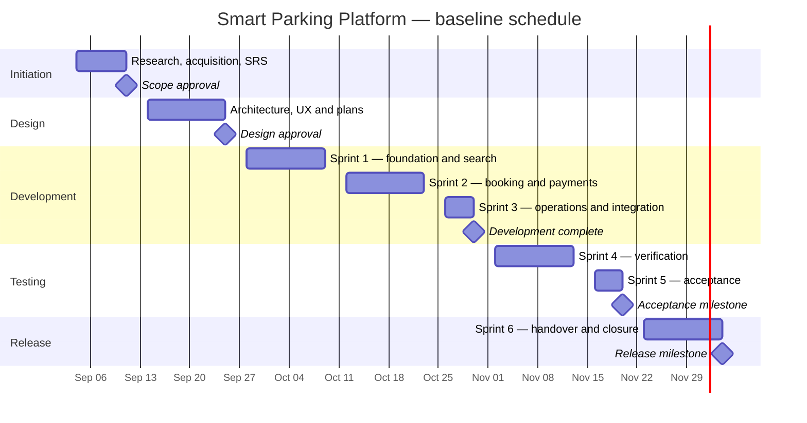

# Smart Parking Platform — Two-Week Completion Package

WE ARE $oftware ¢orp. | Planning baseline: September 4–December 4, 2026 | Sponsor: City of Houston Public Transportation Department

## 1. Competitive analysis

| Competitor | Strengths | Limitations / opportunity for our platform |
|---|---|---|
| SpotHero | Advance reservations, prepaid passes, broad inventory, web/mobile access, operator inventory and pricing tools. | Reservation conditions and availability depend on participating facilities. Offer consistent local garage policies, clearly timestamped availability and accessible search across participating Houston garages. |
| ParkMobile | Mobile payments, advance bookings, parking passes and established Houston locations. | Available amenities and reservation conditions vary by location. Differentiate through a consistent end-to-end garage reservation and operator reporting workflow. |
| Direct garage websites and walk-up parking | Direct facility relationship; familiar on-site processes. | Drivers must compare facilities separately and may not know availability before arrival. Offer consolidated search, booking, navigation and receipts. |

Neither competitor comparison establishes that competitors lack real-time availability or management capabilities. The proposed differentiator is reliable local data and a coordinated operator/customer experience, validated with the sponsor and operators. The initial target is participating Houston garages and lots; monthly parking, enforcement and new sensor installation are excluded unless separately approved.

Sources: [SpotHero customer FAQ](https://spothero.com/faq), [SpotHero operator platform](https://spothero.com/sell-parking/operators), [ParkMobile Houston garage listing](https://parkmobile.io/parking/locations/tx/houston-parking/parking-lot/avenida-central-garage), [ParkMobile Houston lot listing](https://parkmobile.io/parking/locations/tx/houston-parking/parking-lot/lot-1521).

## 2. Brief project acquisition

The City of Houston Public Transportation Department is the proposed sponsor commissioning WE ARE $oftware ¢orp. to design, develop and deploy the platform. Acquire the project through a proposed sponsor-approved statement of work defining scope, deliverables, schedule, acceptance criteria, funding and change control. The PM coordinates acquisition; the PO/BA validates requirements with operators and driver representatives. Obtain operator data-sharing commitments and approved mapping, payment and notification service agreements before integration. Evaluate service providers on API reliability, security/privacy, compatibility, availability commitments, support and total cost. Confirm legal and procurement requirements with the sponsor before executing any agreement. No vendor selection, contract award or approval is represented as complete.

## 3. Work breakdown structure and schedule

| WBS | Work package / deliverable | Owner | Baseline window | Predecessor |
|---|---|---|---|---|
| 1.1 | Market research, acquisition brief | PM / PO/BA | Sep 4–11 | — |
| 1.2 | Stakeholder analysis, SRS, prioritized product backlog | PO/BA | Sep 4–11 | 1.1 (concurrent review) |
| 1.3 | Scope and requirements approval | PO/BA | Sep 11 | 1.1, 1.2 |
| 2.1 | Architecture, API/data design | Backend | Sep 14–25 | 1.3 |
| 2.2 | Accessible web/mobile design and operator workflows | UX/UI | Sep 14–25 | 1.3 |
| 2.3 | WBS, schedule, resource/cost, RACI, risk, communication and charters | PM | Sep 14–25 | 1.3 |
| 2.4 | Design and delivery plan approval | PM | Sep 25 | 2.1–2.3 |
| 3.1 | Accounts, authentication, vehicles, data foundation | Backend / Web / Mobile | Sep 28–Oct 9 | 2.4 |
| 3.2 | Map, search, filters, location details and availability | Mapping / Backend | Sep 28–Oct 9 | 2.4 |
| 3.3 | Reservations, payments, history, receipts, refunds | Backend / Payment | Oct 12–23 | 3.1–3.2 |
| 3.4 | Extensions, cancellation, directions, notifications | Backend / Mapping / Payment | Oct 12–23 | 3.1–3.2 |
| 3.5 | Operator dashboard, pricing, inventory, occupancy and reporting | Backend / Web | Oct 12–30 | 3.1–3.2 |
| 3.6 | Integration and development milestone | Backend | Oct 26–30 | 3.3–3.5 |
| 4.1 | Functional, integration and regression testing | QA | Nov 2–13 | 3.6 |
| 4.2 | Performance, availability, reliability, security and accessibility tests | QA / DevOps | Nov 2–13 | 3.6 |
| 4.3 | Defect correction, regression and stakeholder acceptance | QA / PO/BA | Nov 16–20 | 4.1–4.2 |
| 5.1 | Release readiness, deployment configuration and runbooks | DevOps / PM | Nov 23–Dec 4 | 4.3 |
| 5.2 | Production deployment, monitoring and operations handover | DevOps | Dec 4 | 5.1 |
| 5.3 | Closure report and maintenance proposal; sponsor sign-off | PM | Nov 23–Dec 4 | 4.3; sign-off after 5.2 |

Project monitoring, change control, communication and risk reviews run throughout all phases. Dates are planned milestones from the charter, not claims of actual completion. The closure report's earlier completion dates are explicitly hypothetical actuals and do not replace this baseline.

## 4. Risk analysis

Use the revised risk register as the authoritative risk inventory. Score probability × impact on five-point scales: 1–5 low, 6–10 moderate, 11–15 high, 16–25 critical. Review weekly and immediately following material changes; escalate critical risks to the PM and affected accountable owner. Probability: 1 rare through 5 almost certain; impact: 1 negligible through 5 severe disruption, loss or nonacceptance.

| Category | Principal exposures | Priority response |
|---|---|---|
| Technical | T01 stale feeds (16), T02 conflicting reservations (15), T04 access control (15), integration, notifications, performance, accessibility | Validate timestamps and booking atomically; test provider contracts and access permissions, monitor and rehearse recovery. |
| Schedule | S01 scope growth (16), S04 reduced testing time (16), late access and incompatible interfaces | Freeze baseline, raise dependencies early, protect test window; seek approval to defer optional work. |
| Financial | F02 incorrect charges (12), F04 outages (12), service overruns and disputes | Validate totals and reconciliation, monitor service cost/checkout, correct interrupted transactions. |
| People | P03 communication failures (16), absence, skills and weak stakeholder participation | Assign accountable owners, document interface changes, arrange backup coverage and scheduled reviews. |

Risk closure requires documented evidence of mitigation or accepted residual exposure; open risks remain open until reviewed. Each named owner reports triggers, actions and residual score in the register. Added T08 (backup recovery), T09 (policy/privacy acceptance) and S05 (approval delays) to address residual gaps. Initial scores are planning estimates.

## 5. Governance alignment

- Resource baseline: preserve the existing 3,168 hours and $238,720 labor estimate. Split the combined mapping/payment allocation into two 30% allocations (192 hours each), both at $85/hour. Clarify that these percentages use the original 640-hour inclusive four-month estimating basis; they are functional allocations in a hypothetical staffed studio, not Sean's personal simultaneous availability or a calculation of elapsed weekdays. Confirm staffing capacity against the 13-week calendar at schedule approval. PO/BA responsibilities are assigned to the PM as a combined role within the existing 50% allocation. This maintains the charter's budget and avoids unpriced labor. External operator and finance representatives are consulted stakeholders, not internal labor allocations.
- Cost baseline: use the role-weighted rate of $75.353535/hour (display as $75.35 rounded) rather than a flat $75. Direct labor remains $238,720; 25% overhead is $59,680 and total remains $353,300. The four-month basis is an inclusive September–December planning allowance, not a claim of four full elapsed months.
- The revised RACI is the primary matrix. Add explicit accountability for acquisition, WBS/Gantt, sprint planning and closure; assign sponsor final acceptance and PM release authorization. PM and PO/BA remain distinct decision roles even if the same person fills both.
- Update the stakeholder grid for the fictional project: the sponsoring City department is high power/high interest (manage closely); remove course instructor from the product governance grid. Maintain provider, operator, driver, finance and internal team classifications unless stakeholder feedback supports change.
- Update team charter to reflect split Mapping and Payment roles and combined PM/PO assignment. Update project charter milestone column labels to Planned Date; actual dates belong in closure and remain hypothetical until scenario completion. Remove the flat-rate reconciliation issue once the revised cost plan is adopted.
- Communication plan: retain existing meeting cadences; add sprint planning/review and closure/handover communications, with accountable owners and recorded decisions.

## 6. Post-project maintenance contract proposal (closure report addendum)

WE ARE $oftware ¢orp. proposes a separate twelve-month maintenance agreement commencing after the planned December 4 handover, subject to sponsor approval. The agreement will cover web/mobile and API defect correction, security patches, dependency updates, monitoring, backup/recovery exercises, and compatibility maintenance for mapping, payment and notification services. The team will monitor availability, response times, payment reconciliation and data freshness against the SRS; report monthly to the sponsor and operators; and review recurring defects and risks quarterly. Material feature additions, new garages requiring substantial integration, physical operations, sensors and major scaling initiatives are outside the maintenance agreement and require a separate statement of work.

Proposed support targets: acknowledge critical outages within one hour, prioritize restoration and provide status updates every two hours; acknowledge major issues within one business day; schedule lower-priority fixes in the next maintenance cycle. Targets are proposed, not guaranteed until support coverage and service terms are agreed. Track uptime against the existing 99% monthly SRS target with its stated exclusions. Escalate third-party incidents to the responsible provider and maintain customer/operator communications.

Illustrative annual estimate: 0.25 FTE backend at $85/hr ($44,200), 0.20 FTE DevOps/security at $90/hr ($37,440), 0.15 FTE QA at $55/hr ($17,160), 0.10 FTE PM at $65/hr ($13,520), and 0.10 FTE each Web and Mobile at $75/$80 per hour ($32,240), using 2,080 hours/year. Total labor $144,560; 25% overhead $36,140; hosting/API allowance $84,000 ($7,000/month). Proposed annual total $264,700 ($22,058.33/month). Actual provider fees and staffing must be validated before contracting. This is a separate prospective operating budget, not part of the $353,300 initial development baseline.

At contract end, deliver a maintenance summary, incident and SLA metrics, completed changes, unresolved risks and recommendations for renewal or a separate scaling project. The sponsor and PM approve scope, service levels, cost and renewal before execution.

## 7. Final assembly checklist

Incorporate the competitive analysis, acquisition brief, WBS/Gantt, risk analysis and maintenance proposal into the final project document. Retain the revised SRS, sprint backlogs, resource/cost plan, risk register, communication plan, RACI and charter/grid corrections as supporting artifacts. Use a header, footer, table of contents and figure captions as required by the assignment PDF. Obtain stakeholder and sponsor approval only through the fictional project scenario; do not represent pending approval as signed.

**Baseline references:** Semester Project.pdf (overview, requirements, stakeholders, teams, constraints, competitive analysis and formatting); current repository main branch 957df48 (SRS, revised risk register/RACI, resource/cost plans, communication plan, stakeholder grid, team/project charters, latest closure report); linked Trello board.

## Appendix A — Product and sprint backlogs

The [Trello work board](https://trello.com/b/mksQWn9Z/cis-4374-project-work-board) is authoritative for execution status. Each actual work card identifies its sprint, functional owner and SRS traceability or acceptance criteria. Per-sprint summary cards link the individual tasks. Do not interpret assignment to a past baseline sprint as confirmation that the work was completed.

| Sprint | Goal and backlog themes | Exit evidence |
|---|---|---|
| 1 | Registration/login, vehicles, database, live map, availability, destination search, filters, parking details; web/mobile and security foundations | Customer can find suitable parking using a valid account and working data feed. |
| 2 | Reservations, payments, payment confirmation, modification/cancellation, refunds, history/receipts, extensions, directions, alerts and preferences | Core booking/payment workflow is demonstrable, including policy and failure cases. |
| 3 | Dashboard, inventory, pricing, occupancy, reports, web/mobile completion, security and system integration | Operator and customer workflows integrated and ready for formal testing. |
| 4 | Functional/regression, accessibility/browser, refresh/performance, transaction reliability and availability tests | Traceable QA results and prioritized defects. |
| 5 | Stakeholder acceptance, defect correction and regression review | Acceptance evidence, resolved or approved residual defects and readiness decision. |
| 6 | Release runbooks and monitoring, deployment, handover, closure and maintenance proposal | Authorization, handover record and closure approval. |

The pre-existing saved-payment-methods card is retained as an optional deferred item, subject to approved scope change. It does not expand the baseline SRS automatically.
